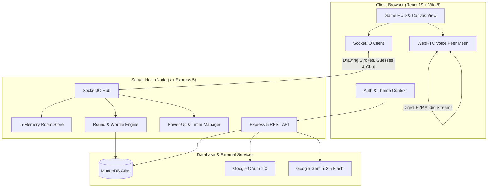

<div align="center">

  <h1>Squiggle</h1>

  <p>
    <strong>Next-generation real-time multiplayer drawing and deduction party game — interactive HTML5 canvas, peer-to-peer WebRTC voice mesh, dynamic Wordle mode, and Google Gemini AI word generation.</strong>
  </p>

  <p>
    <a href="https://squiggle-tgsq.onrender.com"></a>
    
    
    
    
    
    
    
    
    
  </p>

</div>

---

## Table of Contents

- [Overview](#overview)
- [Key Features](#key-features)
- [Game Modes](#game-modes)
- [Tactical Power-Ups & Economy](#tactical-power-ups--economy)
- [Avatar Customization Studio](#avatar-customization-studio)
- [Technology Stack](#technology-stack)
- [System Architecture](#system-architecture)
- [Project Structure](#project-structure)
- [Getting Started](#getting-started)
- [Environment Configuration](#environment-configuration)
- [Production Deployment](#production-deployment)
- [Contributing](#contributing)
- [License](#license)

---

## Overview

**Squiggle** is a modern, high-performance web party game engineered for low latency and high concurrency. Combining classic sketch-and-guess mechanics with innovative party modes, Squiggle offers an interactive social gaming hub directly inside the browser.

Experience the live deployed application on Render:
👉 **[Play Squiggle Live](https://squiggle-tgsq.onrender.com)**

Key highlights include:
- **Low-Latency Canvas Synchronization**: Sub-millisecond broadcast of drawing paths, shapes, and fills over WebSockets.
- **2-Phase Wordle Deduction**: A hybrid mode where guessers tackle 5-letter deduction blindly before the canvas unlocks.
- **P2P Mesh Voice Chat**: Crystal-clear in-game voice communication without dedicated audio media servers.
- **Google Gemini AI Integration**: Dynamic, context-aware prompt generation for endless secret word variety.
- **In-Game Currency & Power-Ups**: Gold Coins and Diamonds enable real-time tactical game modifiers.
- **Expressive Procedural Avatars**: Zero-dependency vector SVG character builder with deep customization.

---

## Key Features

### 🖌️ Interactive HTML5 Drawing Engine
- **Multi-Tool Suite**: Freehand brush, eraser, geometric shapes (rectangle, circle, straight line), and flood-fill bucket.
- **Color & Stroke Control**: Comprehensive palette picker with configurable brush radii.
- **History Stack**: Full `Ctrl+Z` undo/redo support.
- **Optimized Broadcasting**: Coordinate throttling and batching over Socket.IO ensure smooth strokes across high-latency clients.

### 🧩 2-Phase Wordle Deduction Mode
- **Phase 1 (Guesses 1 & 2)**: The canvas remains locked; guessers rely purely on 5-letter deduction with classic Wordle tile clues (🟩 Green for exact position, 🟨 Yellow for included letter, ⬜ Gray for incorrect).
- **Phase 2 (Guesses 3 to 6)**: The canvas unlocks! The drawer illustrates clues to guide remaining guessers.
- **Turn Timeout Safety**: Automatically marks skipped rows if a player runs out of time without submitting a guess.

### 🎙️ Peer-to-Peer WebRTC Voice Mesh
- Direct browser-to-browser audio streaming with zero server-side media relay bottlenecks.
- Individual mic toggle, input gain indicator, and host force-mute moderation.
- Automated peer discovery and signaling cleanup upon player departure.

### 🤖 Google Gemini AI Word Generation
- Generates categorized secret word lists using the Google Gemini 2.5 Flash API.
- Replaces static, predictable dictionaries with creative, culturally nuanced prompts.
- Intelligent fallback to cached local word banks when offline or during rate limits.

### 💬 Live Chat & Guess Stream
- Pill capsule UI design for chat messages in both the pre-game Lobby and active Game Room.
- Automatic guess filtering and answer shielding once a player guesses correctly to prevent spoiling.
- Host broadcast announcements and real-time round status badges.

### 🛡️ Moderation & Fair Play
- Democratic **Vote-Kick System** (30-second consensus window) to remove inactive or toxic players.
- Anti-griefer penalty: Expelled players forfeit **50 Gold Coins**.
- Automatic solo-winner detection and round resolution if opponents disconnect.

### 🏆 Global Leaderboards & Winner Podium
- Dynamic 3-tiered animated podium celebrating 1st, 2nd, and 3rd place champions (or solo victor).
- Persistent player statistics tracking Total Wins, Win Streaks, Gold Coins, and Diamonds.

---

## Game Modes

| Mode | Power-Ups | Word Generation | Description |
|---|:---:|---|---|
| **Standard Mode** | ✅ Enabled | Gemini AI + WordBank | Classic sketch-and-guess with progressive letter clues and power-ups. |
| **Wordle Mode** | ❌ Disabled | 5-Letter Dictionary | 2-phase hybrid: blind Wordle deduction transitioning to canvas sketching. |
| **Genre Selection** | ✅ Enabled | Gemini AI Categorized | Wordlists curated by genre (Animals, Gaming, Movies, Anime, Science, etc.). |
| **Custom Words** | ✅ Enabled | Host-Defined List | Room host supplies secret custom word sets for tailored party play. |

---

## Tactical Power-Ups & Economy

### Power-Ups (Standard Mode)

Power-ups introduce strategic depth during drawing rounds:

- **Freeze Time** (`200 Gold Coins`):
  - Pauses the round countdown clock for **+20 seconds**.
  - Features an exclusive **dual-clock HUD indicator** displaying both the frozen match clock and the freeze bonus countdown.
  - Cost doubles on consecutive activations within the same round (200 ➔ 400 ➔ 800...).
- **Hint Steal** (`100–300 Gold Coins` / `1–2 Diamonds`):
  - Force-reveals an unrevealed letter in the secret word pattern.
  - Dynamically priced according to how many letters remain unrevealed:

| Letters Remaining | Gold Coin Cost | Diamond Cost |
|:---:|:---:|:---:|
| **3 or more** | `100 Coins` | `1 Diamond` |
| **2 letters** | `200 Coins` | `1 Diamond` |
| **1 letter** | `300 Coins` | `2 Diamonds` |

> [!NOTE]
> *Extra Clues* has been intentionally retired from the power-up roster to maintain fair, competitive deduction balance.

---

### In-Game Economy & Rewards

Players earn rewards through skillful deduction, quick drawings, and match victories:

```
┌───────────────────────────────────────────────┬────────────────────────────┐
│ ACTION                                        │ REWARD / PENALTY           │
├───────────────────────────────────────────────┼────────────────────────────┤
│ Correct Guess                                 │ +1 Gold Coin               │
│ Successful Drawing (≥1 guesser succeeds)      │ +2 Gold Coins              │
│ Failed Drawing Round (0 guessers succeed)     │ -1 Gold Coin               │
│ Match Champion                                │ +20 Gold Coins             │
│ Daily Login Bonus                             │ +2 Gold Coins              │
│ Consecutive Win Streak                        │ +1 Diamond (per 2 wins)    │
│ New Player Welcome Gift                       │ +5 Diamonds                │
│ Vote-Kicked Penalty                           │ -50 Gold Coins             │
└───────────────────────────────────────────────┴────────────────────────────┘
```

---

## Avatar Customization Studio

Squiggle features a vector SVG avatar generator built right into the profile page. All assets scale crisply across all resolutions:

- **Hats**: Baseball Cap, Beanie, Cowboy Hat, Top Hat, Wizard Hat.
- **Eyebrows**: Natural, Thick, Raised, Angry (rendered in obsidian `#0f172a`).
- **Eyes**: Normal, Dead (`X_X`), Dots, Girlie, Happy, Wink.
- **Mouths**: Smile, Big Smile, Surprised, Neutral.
- **Moustaches**: Pencil, Chevron, Stubble.
- **Beards**: Clean, Goatee, Full Beard, Chinstrap, Curly, Wizard.
- **Skin Tones**: 6 curated pastel and warm tonal palettes.
- **Instant Randomizer**: Generates randomized character combinations with one click.

---

## Technology Stack

| Domain | Technology | Version | Purpose |
|---|---|---|---|
| **Frontend Framework** | React | `^19.2.6` | Reactive user interface & component state management |
| **Build Tool** | Vite | `^8.0.12` | Instant HMR development and optimized production bundling |
| **Real-Time WebSockets** | Socket.IO Client / Server | `^4.8.3` | Bidirectional room events, canvas strokes, and chat |
| **Voice Communication** | WebRTC | Native Browser API | Full-mesh peer-to-peer real-time audio signaling |
| **Backend Engine** | Node.js / Express | `Node 20+` / `^5.2.1` | High-throughput REST API, routing, and WebSocket hosting |
| **Database & ODM** | MongoDB Atlas / Mongoose | `^9.6.3` | Player profiles, statistics, authentication, and room persistence |
| **Artificial Intelligence** | Google Gemini API (`@google/genai`)| `^2.7.0` | AI-driven dynamic word generation |
| **Authentication** | JWT & Google OAuth | `^9.0.3` / `^10.7.0` | Secure credential hashing (`bcryptjs`) & tokenized auth |
| **Styling** | Vanilla CSS3 | Modern CSS | Dark-mode glassmorphism, responsive HUD, custom SVG icons |

---

## System Architecture



---

## Project Structure

```
Squiggle/
├── client/                         # Frontend Application (React 19 + Vite 8)
│   ├── public/                     # Brand logos, icons, and static assets
│   ├── src/
│   │   ├── components/             # Reusable UI components
│   │   │   ├── Avatar.jsx          # Modular vector SVG avatar component
│   │   │   ├── ColorPicker.jsx     # Canvas color selection palette
│   │   │   ├── DraggableGuessWindow.jsx # Movable in-game guess & chat capsule
│   │   │   ├── DrawingCanvas.jsx   # HTML5 drawing engine with shapes & tools
│   │   │   ├── ErrorBoundary.jsx   # Application error boundary
│   │   │   ├── PowerupsPanel.jsx   # In-game power-up trigger interface
│   │   │   ├── SquiggleLogo.jsx    # Vector logo SVG
│   │   │   ├── ToolBar.jsx         # Canvas brush/shape/eraser toolbar
│   │   │   └── WordleBoard.jsx     # Wordle tile matrix & deduction feedback
│   │   ├── context/                # Global context providers (Auth, Currency)
│   │   ├── hooks/                  # Custom React hooks (useCanvas, useWebRTC)
│   │   ├── pages/                  # Page routes
│   │   │   ├── ForgotPassword.jsx  # Password recovery request
│   │   │   ├── GamePage.jsx        # 3-column gameplay HUD & canvas stage
│   │   │   ├── Home.jsx            # Landing page with interactive hero
│   │   │   ├── LeaderboardPage.jsx # Global rank standings
│   │   │   ├── LobbyPage.jsx       # Public/private room browser & creator
│   │   │   ├── Login.jsx           # User authentication
│   │   │   ├── ProfilePage.jsx     # User stats, rank, and Avatar Studio
│   │   │   ├── Register.jsx        # Account registration
│   │   │   └── ResetPassword.jsx   # Token-based password reset
│   │   ├── styles/                 # Scoped stylesheets
│   │   └── main.jsx                # Application root with Suspense code-splitting
│   └── vite.config.js              # Vite bundler & development proxy config
├── server/                         # Backend Application (Node.js & Express 5)
│   ├── models/                     # Mongoose schemas (User, Room, Reward)
│   ├── routes/                     # Express REST API routes (auth, rooms, users)
│   ├── services/                   # Gemini AI word generation service
│   ├── socket/                     # Modular Socket.IO event handlers
│   │   ├── buildRoomState.js       # Sanitized room state serializer
│   │   ├── drawingEvents.js        # Canvas stroke & shape broadcasting
│   │   ├── gameEvents.js           # Room joining, chat, guesses, lifecycle
│   │   ├── powerupEvents.js        # Power-up purchases & timer freeze
│   │   ├── roomStore.js            # In-memory fast room cache
│   │   ├── roundManager.js         # Round progression & score calculations
│   │   ├── voiceEvents.js          # WebRTC signaling mesh
│   │   └── voteKickEvents.js       # Vote-kick consensus & penalty logic
│   ├── utils/                      # WordBank, Wordle helper, auth middleware
│   └── index.js                    # Express 5 entrypoint, static serving & Socket.IO
├── package.json                    # Workspace dependencies & root scripts
└── README.md                       # Documentation
```

---

## Getting Started

### Prerequisites
- [Node.js](https://nodejs.org) >= 20.0.0
- [npm](https://npmjs.com) >= 9.0.0
- [MongoDB](https://www.mongodb.com) (Local instance or MongoDB Atlas URI)

### Quick Setup

```bash
# 1. Clone repository
git clone https://github.com/zahin002/Squiggle.git
cd Squiggle

# 2. Install all dependencies (root server & client)
npm run install:all

# 3. Configure environment variables
cp .env.example .env

# 4. Start concurrent development servers
npm run dev
```

The application will be accessible at:
- **Client Frontend**: `http://localhost:5173`
- **Backend API & WebSockets**: `http://localhost:5000`

---

## Environment Configuration

Create a `.env` file in the root directory (or inside `server/.env`):

```env
# ── Server Configuration ─────────────────────────────────────
PORT=5000
NODE_ENV=development
CLIENT_URL=http://localhost:5173

# ── Database ─────────────────────────────────────────────────
MONGO_URI=mongodb+srv://<username>:<password>@cluster0.mongodb.net/squiggle

# ── Authentication ───────────────────────────────────────────
JWT_SECRET=your_super_secret_jwt_key
JWT_EXPIRES_IN=7d
GOOGLE_CLIENT_ID=your_google_oauth_client_id

# ── AI Word Generation (Google Gemini) ───────────────────────
GEMINI_API_KEY=your_gemini_api_key

# ── Password Recovery SMTP (Optional) ────────────────────────
SMTP_HOST=smtp.ethereal.email
SMTP_PORT=587
SMTP_USER=your_smtp_user
SMTP_PASS=your_smtp_password
```

---

## Production Deployment

### Option A: Unified Fullstack Deployment (Recommended: Render, Railway, VPS)
The Express 5 server includes built-in static asset serving for the compiled Vite frontend:

```bash
# 1. Compile client production bundle
npm run build

# 2. Start the unified production server
npm start
```
> [!TIP]
> Express automatically serves the compiled React application from `client/dist`, hosting the REST API, Socket.IO hub, and static assets from a single port without cross-origin friction.

### Option B: Split Deployment (e.g. Vercel Frontend + Render Backend)
- **Frontend (Vercel / Netlify)**:
  - Root directory: `client`
  - Build command: `npm run build`
  - Output directory: `dist`
  - Environment variable: `VITE_API_URL=https://your-backend.onrender.com`
- **Backend (Render / Railway / Fly.io)**:
  - Root directory: `./`
  - Build command: `npm install`
  - Start command: `node server/index.js`
  - Environment variable: `CLIENT_URL=https://your-frontend.vercel.app`

---

## Contributing

Contributions make the open-source community an inspiring place to learn and create. Any contributions you make are **greatly appreciated**.

1. Fork the Project.
2. Create your Feature Branch:
   ```bash
   git checkout -b feature/AmazingFeature
   ```
3. Commit your Changes:
   ```bash
   git commit -m "feat: Add AmazingFeature"
   ```
4. Push to the Branch:
   ```bash
   git push origin feature/AmazingFeature
   ```
5. Open a Pull Request.

---

## License

Distributed under the **MIT License**. See [`LICENSE`](LICENSE) for more information.

<div align="center">
  <p>Crafted with ❤️ by <a href="https://github.com/zahin002">zahin002</a></p>
</div>
